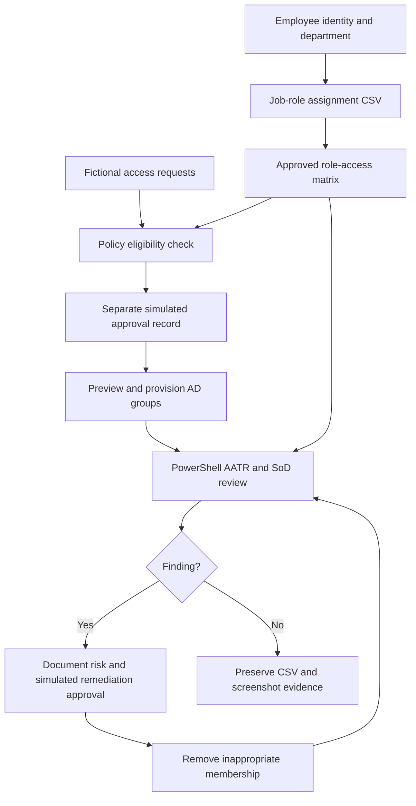
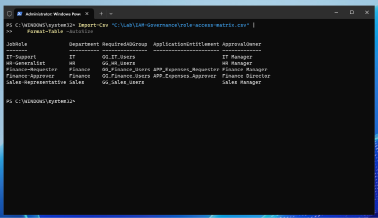
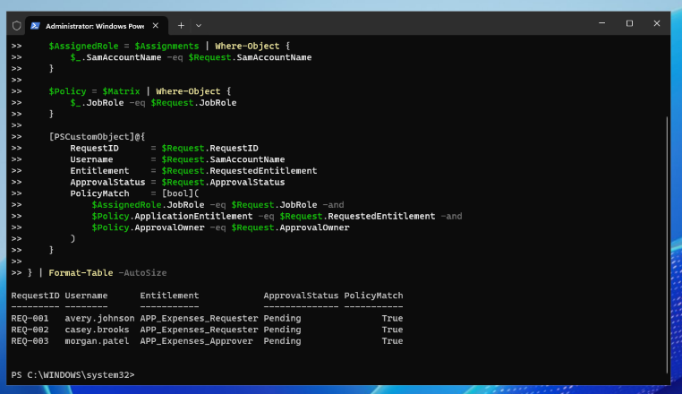
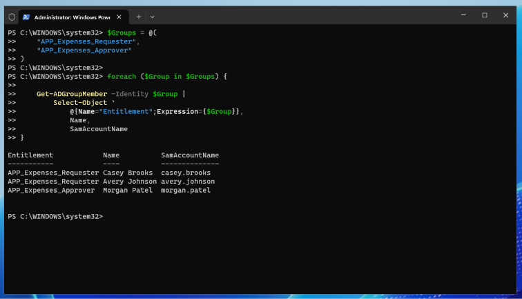
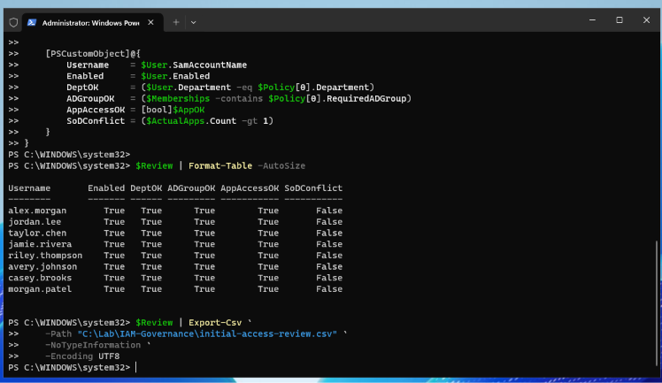
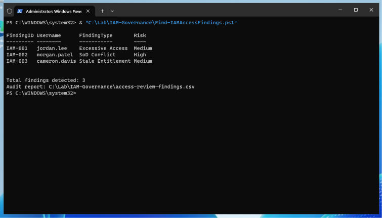
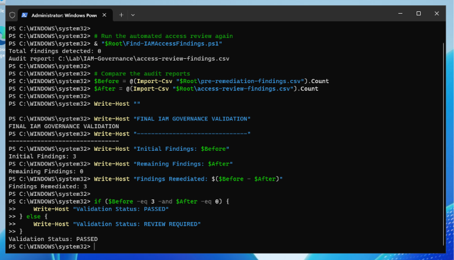

# Enterprise IAM Access Governance & Role-Based Access Reviews

**A Windows Server 2025 / Active Directory home-lab project demonstrating access-request controls, role-based entitlements, Access Appropriate to Role (AATR) reviews, separation-of-duties (SoD) testing, remediation, and audit evidence.**

**Technology:** Windows Server 2025 · Active Directory Domain Services · PowerShell · CSV · RBAC · Least Privilege · IAM Governance

> **Lab integrity:** All users, request IDs, approvals, and expense application entitlements are fictional. The "APP_Expenses_*" AD security groups simulate application permissions; no real financial application or external manager approved the actions. All changes were made within an isolated lab.

## Executive Summary

Extended a previously built Active Directory environment to simulate an IAM operational and governance workflow. Created an approved role-to-entitlement matrix, assigned roles to eight active employees, validated three fictional access requests against the policy and separate simulated approvals, and provisioned the corresponding AD group memberships. Performed clean baseline access reviews, intentionally introduced three access-control exceptions, developed and ran a read-only PowerShell findings detector, and then restored access using documented simulated remediation decisions and `-WhatIf` previews.

| Measured result | Lab outcome |
|---|---|
| Identities reviewed for coverage | **9** — 8 enabled and 1 disabled |
| Active employee role assignments | **8** |
| Simulated approved provisioning requests | **3** |
| Deliberately introduced findings | **3** |
| Findings remediated | **3 of 3** |
| Remaining **in-scope** findings after retest | **0** |
| Evidence files verified on DC01 | **10 of 10** expected files present |

**Outcome:** 100% of the **three intentionally introduced, in-scope lab findings** were remediated. This is not a claim of full Active Directory compliance, enterprise-wide entitlement coverage, or a production audit.

## Quick Navigation

- [Environment & Architecture](#environment--architecture)
- [Approved RBAC Model](#approved-rbac-model)
- [Project Workflow & Evidence](#project-workflow--evidence)
- [Three IAM Findings](#three-iam-findings)
- [PowerShell Detection and Retest](#powershell-detection-and-retest)
- [Artifacts & File Structure](#artifacts--file-structure)
- [Scope, Controls & Limitations](#scope-controls--limitations)
- [Lessons Learned](#lessons-learned)
- **[Final audit report](docs/Final-IAM-Governance-Audit-Report.md)** · **[Screenshot evidence index](docs/Evidence-Index.md)** · **[Reproduction guide](docs/Reproduction-and-Safety.md)**

## Environment & Architecture

This project reused an existing VMware Workstation lab rather than creating another server.

| Component | Configuration |
|---|---|
| Domain controller | `DC01` — Windows Server 2025 / AD DS / DNS |
| AD domain | `corp.tetsalab.test` |
| Domain-joined client | `CLIENT01` — Windows 11 Pro |
| Lab network | VMware host-only subnet `192.168.184.0/24` |
| Working folder on DC01 | `C:\Lab\IAM-Governance` |
| Users | IT (3), HR (2), Finance (3), disabled Sales (1) |
| Governed entitlements | `APP_Expenses_Requester` and `APP_Expenses_Approver` — **simulated application access** |



## Approved RBAC Model

An employee's **department is not sufficient to authorize every permission**. Finance uses two distinct job roles, each with one expense entitlement, to separate request initiation from approval.

| Job role | Required departmental group | Simulated expense entitlement | Designated owner role |
|---|---|---|---|
| IT-Support | `GG_IT_Users` | None | IT Manager |
| HR-Generalist | `GG_HR_Users` | None | HR Manager |
| Finance-Requester | `GG_Finance_Users` | `APP_Expenses_Requester` | Finance Manager |
| Finance-Approver | `GG_Finance_Users` | `APP_Expenses_Approver` | Finance Director |
| Sales-Representative | `GG_Sales_Users` | None | Sales Manager |

See the [original role-access matrix](data/policy/role-access-matrix.csv) and [employee-role assignments](data/policy/employee-role-assignments.csv).



## Project Workflow & Evidence

### 1. Inventory all identities and define approved access

Queried the TetsaLab OU, including the disabled-user OU, and confirmed eight enabled accounts and one disabled account (`cameron.davis`). Established the role matrix and mapped the eight active employees to job roles.

[Complete identity inventory](screenshots/02-complete-iam-user-inventory.png) · [Role assignment validation](screenshots/05-employee-role-assignment-validation.png)

### 2. Validate requests separately from approvals

Created three fictional, initially **pending** access requests. Verified policy eligibility, then recorded separate **simulated** manager-role decisions. The lab deliberately distinguishes *entitlement eligibility*, *approval*, and *actual provisioning*.



[Simulated approval validation](screenshots/07-iam-management-approval-validation.png) · [Request data](data/requests/access-requests.csv) · [Approval records](data/requests/approval-decisions.csv)

### 3. Provision and verify only the expected access

Previewed three `Add-ADGroupMember` operations with `-WhatIf`, then assigned Avery Johnson and Casey Brooks to Requester and Morgan Patel to Approver. Independently verified direct group membership after execution.



### 4. Establish clean AATR and account coverage baselines

Reviewed each active employee's enabled status, department, required AD group, expected expense entitlement, and SoD conflict status; all eight passed the defined checks. A separate review covered all nine identities for disabled-user and unassigned-user direct expense entitlements.



[Disabled / unassigned account review](screenshots/11-disabled-account-access-review.png) · [Initial AATR CSV](data/reviews/initial-access-review.csv) · [Coverage CSV](data/reviews/initial-account-coverage.csv)

### 5. Introduce test exceptions and detect them automatically

Intentionally added three noncompliant group memberships **within the isolated test domain**, then executed the original `Find-IAMAccessFindings.ps1` detection script. The script flagged all three and exported a detailed CSV findings report.



[Controlled membership evidence](screenshots/13-controlled-iam-security-findings.png) · [Detailed investigation](screenshots/15-iam-security-findings-detailed-review.png) · [Pre-remediation findings CSV](data/findings/pre-remediation-findings.csv)

### 6. Remediate, independently validate, and preserve evidence

Recorded separate simulated remediation decisions, verified the corresponding memberships, previewed removals using `-WhatIf`, and removed only the three intentionally introduced entitlements. Verified legitimate memberships remained and the disabled account stayed disabled. Reran the detection script; the final exported report contained **zero finding rows**.



[Simulated remediation decisions](data/requests/remediation-approvals.csv) · [Post-remediation memberships](screenshots/18-iam-access-remediation-verification.png) · [Post-remediation findings CSV](data/findings/post-remediation-findings.csv) · [Evidence file inventory](screenshots/20-iam-governance-audit-evidence-inventory.png)

## Three IAM Findings

| ID | Account | Condition tested | Illustrative lab risk | Correction and retest |
|---|---|---|---|---|
| **IAM-001** | `jordan.lee` | IT user granted Expense Approver access, outside approved role | Medium | Removed `APP_Expenses_Approver` |
| **IAM-002** | `morgan.patel` | Finance Approver also assigned Expense Requester, violating fictional SoD rule | High | Removed Requester, retained Approver |
| **IAM-003** | `cameron.davis` | Disabled account retained direct Requester group membership | Medium | Removed Requester, account remained disabled |

The risk ratings are educational classifications rather than formally approved organizational risk scores. A retained group membership on a disabled account is an **entitlement cleanup concern**; it does not establish successful authentication or real application access.

## PowerShell Detection and Retest

**Original lab script:** [`scripts/Find-IAMAccessFindings.ps1`](scripts/Find-IAMAccessFindings.ps1)

The script:

1. Queries all lab identities under `OU=TetsaLab`.
2. Enumerates **direct user memberships** in the two simulated expense groups.
3. Compares current access to the CSV role definitions and assignments.
4. Detects stale entitlements, unauthorized access, requester/approver conflicts, and missing required entitlements.
5. Writes `access-review-findings.csv`, including a header-only report when the result has zero findings.

**Example (DC01, after configuring the documented prerequisites):**

```powershell
& "C:\Lab\IAM-Governance\Find-IAMAccessFindings.ps1"
```

The script **does not change AD access**; it **does overwrite the local `access-review-findings.csv` report** when run. Preserve old reports before reruns. [Read the reproduction and safety guide](docs/Reproduction-and-Safety.md).

## Artifacts & File Structure

```text
Enterprise-IAM-Access-Governance-and-Access-Reviews/
├── README.md
├── docs/
│   ├── Final-IAM-Governance-Audit-Report.md
│   ├── Evidence-Index.md
│   └── Reproduction-and-Safety.md
├── scripts/
│   └── Find-IAMAccessFindings.ps1
├── data/
│   ├── policy/                 # Approved fictional roles and assignments
│   ├── requests/               # Fictional requests and simulated approvals
│   ├── reviews/                # Clean baseline AATR and account coverage
│   └── findings/               # Preserved pre- and post-remediation results
└── screenshots/               # 01 through 20, including 19b
```

Explore all screenshots in the [Evidence Index](docs/Evidence-Index.md), which maps each image to a specific validation step and clearly identifies simulated activities.

## Scope, Controls & Limitations

- **In scope:** Nine lab identities and two simulated expense entitlement groups, using direct group memberships; defined role mappings, access requests, approval simulation, before/after review, and audit documentation.
- **Not in scope:** Real application permission enforcement, authenticated manager approvals, Entra ID Governance access reviews, nested/effective group memberships, privileged roles, production ITSM workflows, or an independent compliance audit.
- **Role-review distinction:** The initial AATR check verifies that required departmental groups exist, but does not systematically identify **all other unauthorized AD group memberships**.
- **Approval evidence:** Every approval in this repository is explicitly labeled `Simulated`. Files were locally generated and are not externally attested or immutable records.
- **Audit conclusion:** All three known, intentionally introduced exceptions were cleared. Zero findings applies to the **checks implemented by this lab script**, not all possible security risks.

## Lessons Learned

- Build a policy and job-role baseline **before** examining access; otherwise a finding lacks a defensible comparison point.
- Treat role eligibility, business-owner authorization, provisioning, and post-change verification as different controls.
- Separate Requester and Approver permissions to illustrate prevention and detection of SoD conflicts.
- Include disabled and unassigned accounts in periodic reviews; a clean active-user report alone is incomplete.
- Use `-WhatIf` and preserve pre-remediation evidence before modifying memberships or overwriting CSV reports.
- For enterprise use, add authenticated approval records, timestamps, periodic recertification, effective/nested access enumeration, and integration with HR and ITSM sources.

## Project Status

**Status:** Completed — Controlled IAM access review and remediation cycle  
**Project type:** IAM Operations · Identity Governance · IT Controls / GRC Home Lab  
**Focus:** AATR · RBAC · Joiner–Mover–Leaver validation · Least Privilege · SoD · Audit Evidence  
**Result:** **3 intentionally introduced in-scope findings detected and remediated; 0 remaining in-scope findings**

## Author

**Sammy Tetzba**  
CompTIA Security+ · Microsoft Certified: Azure Fundamentals (AZ-900)  
*IT Infrastructure · Identity & Access Management (IAM) · PowerShell Automation · Cybersecurity*  
[GitHub Portfolio](https://github.com/TetsaLab)

---

*All activities were performed in a controlled home-lab environment for skills development and portfolio demonstration. Sample users and access records are fictional.*
